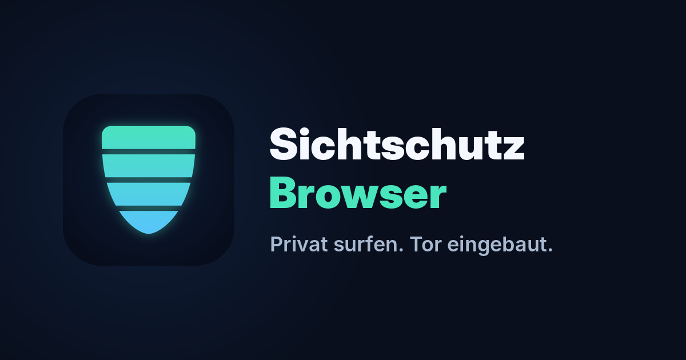
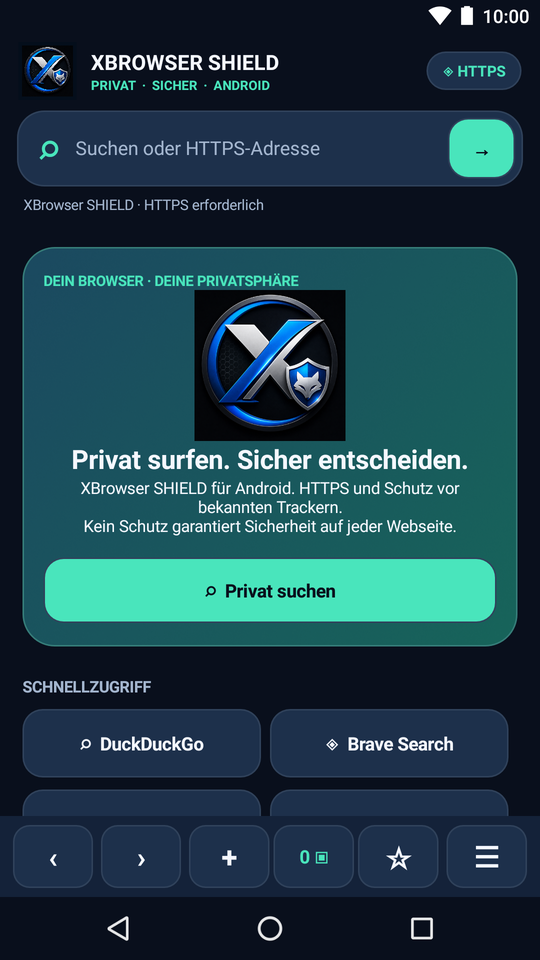
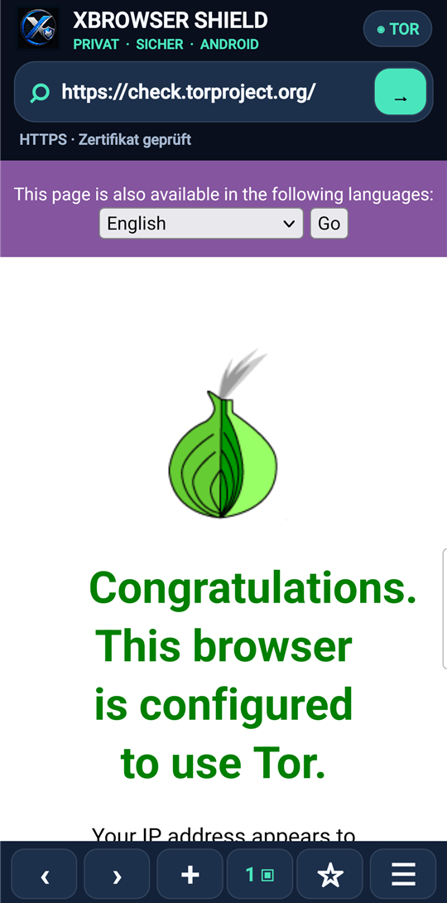
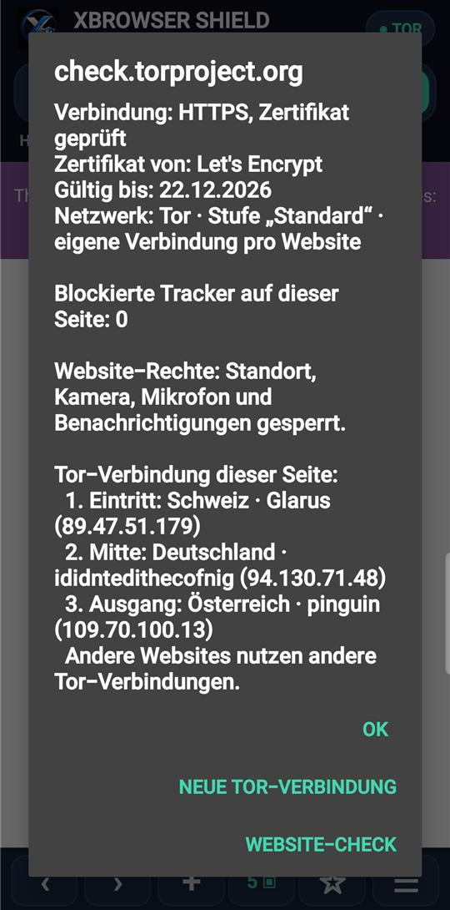
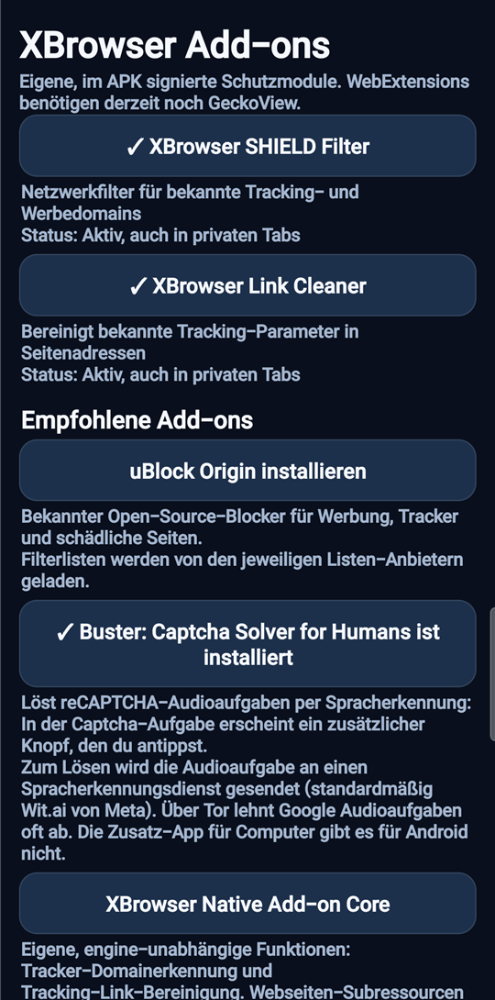
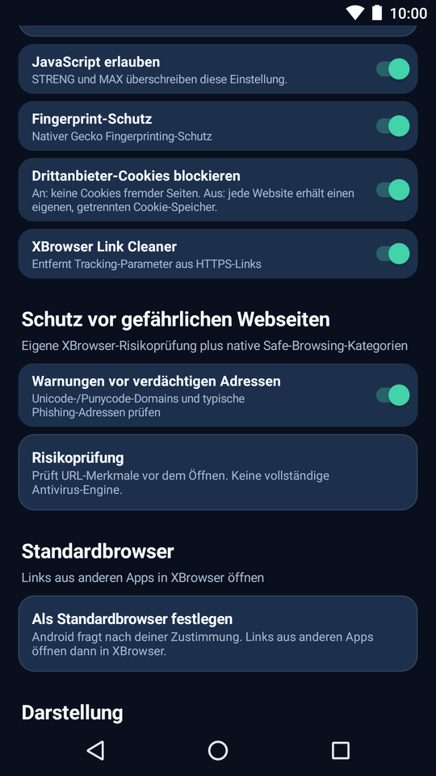
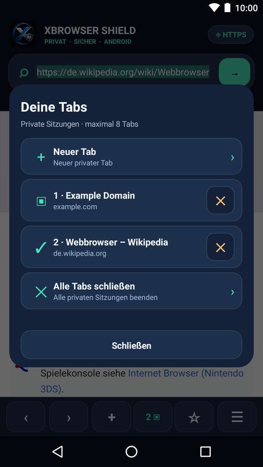
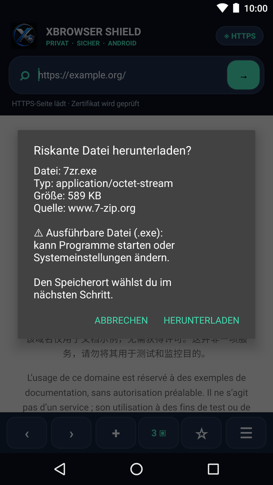
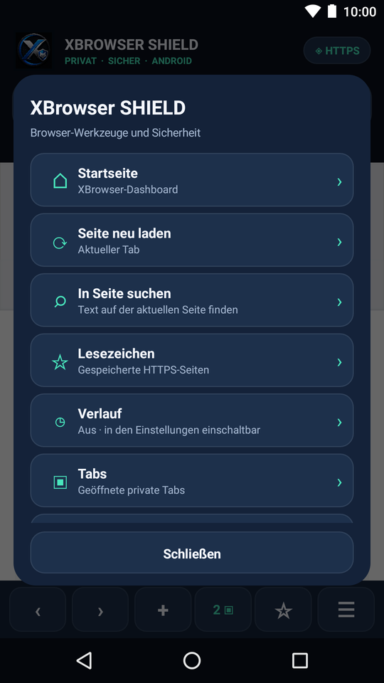

<p align="center">
  
</p>

<p align="center">
  <a href="https://github.com/anonymex3/XBrowser-SHIELD-DOWNLOADS/releases/latest"></a>
  
  
  
  
</p>

<p align="center">
  <a href="https://github.com/anonymex3/XBrowser-SHIELD-DOWNLOADS/releases/download/android-v1.4.1/XBrowser-SHIELD-Android8-1.4.1-ARM64.apk"></a>
  <br>
  <sub>Für fast alle Handys · andere Geräte: <a href="https://github.com/anonymex3/XBrowser-SHIELD-DOWNLOADS/releases/download/android-v1.4.1/XBrowser-SHIELD-Android8-1.4.1-ARMv7.apk">ARMv7 (32-Bit)</a> · <a href="https://github.com/anonymex3/XBrowser-SHIELD-DOWNLOADS/releases/download/android-v1.4.1/XBrowser-SHIELD-Android8-1.4.1-x86_64.apk">x86_64</a> · <a href="https://github.com/anonymex3/XBrowser-SHIELD-DOWNLOADS/releases/tag/android-v1.4.1">alle Dateien &amp; Prüfsummen</a></sub>
</p>

<p align="center">
  <a href="#warum-xbrowser-shield">Warum?</a> ·
  <a href="#so-sieht-es-aus">Screenshots</a> ·
  <a href="#download-und-installation">Installation</a> ·
  <a href="#funktionen">Funktionen</a> ·
  <a href="#tor--direkt-eingebaut">Tor</a> ·
  <a href="#datenschutz">Datenschutz</a> ·
  <a href="#häufige-fragen">FAQ</a> ·
  <a href="#english">English</a>
</p>

**XBrowser SHIELD** ist ein Webbrowser für Android, bei dem Privatsphäre die Grundeinstellung ist – nicht ein Schalter, den man erst suchen muss. Webseiten stellt **Mozilla GeckoView** dar, die Engine von Firefox, mit Mozillas Sicherheitsupdates. Darum herum legt XBrowser eigene Schutzschichten: nur verschlüsselte Verbindungen, private Tabs, Tracker- und Link-Filter, sichere Downloads und auf Wunsch **Tor direkt in der App**.

> **Kein Konto. Keine Werbung. Keine Analyse-Dienste. Keine Absturzberichte.**
> X-Projekt erfährt nicht, welche Seiten du besuchst oder was du suchst.

## Warum XBrowser SHIELD?

| 🔒 **Nur HTTPS** | 🕶 **Privat ab Werk** | 🛡 **Tracker-Schutz** |
|---|---|---|
| Unverschlüsselte Seiten werden nicht geladen, `http://`-Links automatisch zu `https://`. Ein Tipp zeigt das Zertifikat. | Jeder Tab ist privat. Cookies und Website-Daten sind weg, sobald die Tabs zu sind. Verlauf ist aus. | Strenger Schutz von Mozilla, eigener SHIELD-Filter und Link-Bereinigung – mit Zähler „7 Tracker blockiert“. |
| 🧅 **Tor eingebaut** | 🧩 **Add-ons** | 🔄 **Updates automatisch** |
| Ohne Zusatz-App: eigene Tor-Verbindung pro Website, Relais-Anzeige, `.onion`-Seiten und Brücken gegen Sperren. | uBlock Origin und Buster (Captcha-Hilfe) mit einem Tipp, direkt von Mozilla signiert. | Neue Versionen werden geladen, geprüft und installiert – mit Benachrichtigung. Nur Dateien mit dem Schlüssel von X-Projekt. |

## So sieht es aus

<table>
  <tr>
    <td align="center"><br><sub>Startseite</sub></td>
    <td align="center"><br><sub>Tor bestätigt</sub></td>
    <td align="center"><br><sub>Tor-Relais pro Seite</sub></td>
    <td align="center"><br><sub>Add-ons</sub></td>
  </tr>
  <tr>
    <td align="center"><br><sub>Schutzeinstellungen</sub></td>
    <td align="center"><br><sub>Private Tabs</sub></td>
    <td align="center"><br><sub>Warnung vor riskanten Dateien</sub></td>
    <td align="center"><br><sub>Menü</sub></td>
  </tr>
</table>

## Download und Installation

**Aktuelle Version: [XBrowser SHIELD 1.4.1](https://github.com/anonymex3/XBrowser-SHIELD-DOWNLOADS/releases/tag/android-v1.4.1)** · Android 8.0 oder neuer

| Datei | Für welches Gerät? | Größe |
|---|---|---|
| [**ARM64**](https://github.com/anonymex3/XBrowser-SHIELD-DOWNLOADS/releases/download/android-v1.4.1/XBrowser-SHIELD-Android8-1.4.1-ARM64.apk) | **Fast alle Handys und Tablets** – im Zweifel diese | 224 MB |
| [ARMv7](https://github.com/anonymex3/XBrowser-SHIELD-DOWNLOADS/releases/download/android-v1.4.1/XBrowser-SHIELD-Android8-1.4.1-ARMv7.apk) | Ältere oder günstige Geräte mit 32-Bit-Prozessor | 185 MB |
| [x86_64](https://github.com/anonymex3/XBrowser-SHIELD-DOWNLOADS/releases/download/android-v1.4.1/XBrowser-SHIELD-Android8-1.4.1-x86_64.apk) | Emulatoren, Chromebooks mit Intel-/AMD-Prozessor | 246 MB |

1. Die passende APK **auf dem Handy** herunterladen und öffnen.
2. Android fragt einmal, ob dein Browser oder Dateimanager Apps installieren darf („Unbekannte Apps installieren“) – erlauben.
3. „Installieren“ tippen. Danach kannst du die Erlaubnis wieder entziehen.

Meldet Android „App nicht installiert“, passt die Architektur nicht – dann die ARMv7-Datei nehmen.

**Updates kommen ab 1.4.1 automatisch:** XBrowser lädt neue Versionen im Hintergrund, prüft sie und installiert sie, sobald er nicht auf dem Bildschirm ist. Beim ersten Update fragt Android einmal, ob XBrowser Apps installieren darf (Android 8 bis 11: bei jedem Update ein Tipp auf „Installieren“). Lesezeichen und Einstellungen bleiben erhalten. Wer noch 1.4.0 oder 1.3.x hat, installiert 1.4.1 einmal von Hand darüber.

<details>
<summary><b>Download prüfen (empfohlen)</b></summary>

1. **Prüfsumme:** Der SHA-256-Wert der Datei muss mit [`SHA256SUMS.txt`](https://github.com/anonymex3/XBrowser-SHIELD-DOWNLOADS/releases/download/android-v1.4.1/SHA256SUMS.txt) übereinstimmen.
   - Windows: `Get-FileHash .\XBrowser-SHIELD-Android8-1.4.1-ARM64.apk -Algorithm SHA256`
   - macOS / Linux: `shasum -a 256 XBrowser-SHIELD-Android8-1.4.1-ARM64.apk`
2. **Signatur:** Alle APKs sind mit demselben Schlüssel von X-Projekt signiert (APK-Signatur v2 und v3). Zertifikat SHA-256:
   ```
   0827ba16bec12379e935072c82130cd33e892732a72ad5fa5325b65136c169dd
   ```
   Prüfen mit `apksigner verify --print-certs <Datei>.apk` aus dem Android SDK. Android selbst lehnt jedes Update ab, das mit einem anderen Schlüssel signiert ist.
</details>

## Funktionen

### 🕶 Privatsphäre
- **Private Tabs:** Cookies, Cache und Website-Daten bleiben nur im Arbeitsspeicher und verschwinden, sobald alle Tabs geschlossen sind. „Alles löschen“ entfernt sie sofort.
- **Vollständiger Cookie-Schutz:** eigener Cookie-Speicher pro Website, Drittanbieter-Cookies gesperrt, dazu Schutz vor Bounce-Tracking, E-Mail-Trackern und Social-Media-Trackern.
- **Fingerprint-Schutz** der Engine und **Global Privacy Control** (Bitte an Webseiten, keine Daten zu verkaufen oder zu teilen).
- **Link Cleaner** entfernt Tracking-Parameter wie `utm_…` oder `fbclid` aus Links.
- **Verlauf standardmäßig aus.** Eingeschaltet bleibt er nur auf dem Gerät, im Tor-Modus wird er nie geschrieben, Ausschalten löscht ihn vollständig.
- **Bildschirmschutz** wie bei privaten Fenstern in Firefox: keine Screenshots und keine Vorschau in „Zuletzt verwendet“ (abschaltbar). Die Tastatur bekommt das Inkognito-Signal.
- **Keine Website-Rechte:** Standort, Kamera, Mikrofon und Benachrichtigungen sind gesperrt.
- App-Daten sind von Android-Cloud-Backups und Geräteumzügen ausgeschlossen.

### 🛡 Sicherheit
- **Nur HTTPS** mit Seiteninfo: Ein Tipp auf „HTTPS“ zeigt Zertifikat, Gültigkeit, Netzwerk, blockierte Tracker und gesperrte Rechte.
- **Heimnetz geschützt:** Webseiten erreichen weder dein Gerät noch Router oder andere Geräte im lokalen Netz (Schutz vor DNS-Rebinding und Router-Angriffen).
- **Warnung vor verdächtigen Adressen** (Punycode, ungewöhnliche Domains, Phishing-Begriffe) plus Google Safe Browsing über die Engine. Anmelde-Dialoge aus eingebetteten fremden Inhalten tragen eine Phishing-Warnung.
- **Sichere Downloads:** nur von HTTPS-Quellen und nur nach Bestätigung. Riskante Dateien (App-Pakete, ausführbare Dateien, doppelte Endungen) lösen eine Warnung aus und werden nie direkt geöffnet.
- **Links in andere Apps** (`mailto:`, `tel:`, `sms:`, `geo:`) nur nach Bestätigung; USSD-/MMI-Codes werden abgelehnt, `intent:`, `market:`, `file:` und `content:` bleiben gesperrt.
- **Schutzprofile** STANDARD, STRENG und MAX (STRENG und MAX ohne JavaScript).
- **Verschlüsseltes DNS** über DNS.SB (DNS-over-HTTPS), optional.
- **Kein veralteter Browser:** Nach 30 Tagen erinnert XBrowser an ein Update, ab Tag 90 schränkt er Webseiten ein, ab Tag 100 lädt er keine mehr.

### 🧩 Add-ons
- **uBlock Origin** – Blocker für Werbung, Tracker und schädliche Seiten.
- **Buster: Captcha Solver for Humans** – löst reCAPTCHA-Audioaufgaben per Spracherkennung; in der Captcha-Aufgabe erscheint ein zusätzlicher Knopf.
- Beide mit einem Tipp von addons.mozilla.org (von Mozilla signiert), jederzeit abschaltbar oder entfernbar. Weitere von Mozilla signierte Add-ons lassen sich als XPI-Datei installieren.

### 📱 Alltag
- Bis zu 8 Tabs, Pop-ups nur mit Abfrage, Lesezeichen als Kacheln auf der Startseite.
- Suche mit DuckDuckGo (Standard), Brave Search, Startpage, Mojeek oder Google; Suche in der Seite mit Trefferzähler.
- Downloads nach „Downloads/XBrowser“ ohne Speicherberechtigung.
- Datei-Upload, Datums-, Farb- und Auswahlfelder, Anmeldedialoge, Vollbild-Video, Langdruck-Menü für Links und Bilder, Teilen.
- Als **Standardbrowser** wählbar · Hell/Dunkel · Textgröße · Desktop-Ansicht · Hardware-Tastaturen.

## Tor – direkt eingebaut

**Einschalten:** Einstellungen → Tor → „Integrierter Tor-Dienst“ → XBrowser startet mit einem Tipp neu. XBrowser startet Tor lokal auf dem Handy, bestätigt den Tor-Ausgang über `check.torproject.org` und lädt **bis dahin keine Seite**.

- **Angebunden wie im Tor Browser:** SOCKS5, Namensauflösung im Tor-Netz – nie auf deinem Gerät. Lokales DNS, WebRTC, Standort, Vorab-Verbindungen und Direkt-Fallback sind aus.
- **Eigene Tor-Verbindung pro Website:** Verschiedene Websites laufen über verschiedene Tor-Wege und lassen sich nicht über einen gemeinsamen Ausgang verknüpfen.
- **Relais sehen:** Ein Tipp auf „◉ TOR“ zeigt Eintritt, Mitte und Ausgang der Seite mit Land.
- **„Neue Tor-Verbindung für diese Seite“** und **„Neue Tor-Identität“** im Menü.
- **Onion-Dienste:** `.onion`-Adressen funktionieren; bietet eine Website eine .onion-Version an, zeigt XBrowser das an oder öffnet sie automatisch.
- **Brücken** gegen Tor-Sperren: obfs4, Snowflake, meek oder eigene. Ist eine gewählte Brücke nicht nutzbar, verbindet XBrowser **gar nicht** statt ungeschützt direkt.
- **Sicherheitsstufen** wie im Tor Browser: Standard · Sicherer · Am sichersten (JavaScript aus).

Getestet auf einem Samsung Galaxy S21: Tor bestätigt nach 9–17 Sekunden, verschiedene Ausgänge pro Website, .onion-Seiten, Snowflake-Brücke nach rund 45 Sekunden.

## Datenschutz

XBrowser speichert Einstellungen, Lesezeichen und – nur wenn du ihn einschaltest – den Verlauf **auf deinem Gerät**. Die App selbst verbindet sich nur mit:

| Wohin | Wann |
|---|---|
| Webseiten und deine gewählte Suchmaschine | wenn du sie aufrufst |
| Mozilla und Google Safe Browsing | Schutzlisten der Engine – ohne besuchte Adressen im Klartext |
| GitHub | höchstens alle 6 Stunden: signierte Update-Information; bei einer neuen Version die neue App-Datei |
| Tor-Netz und `check.torproject.org` | nur im Tor-Modus |
| DNS.SB | nur wenn du verschlüsseltes DNS einschaltest |

Vollständige [Datenschutzerklärung](https://xbrowser.xanonymeki.net/datenschutz/) · [Privacy Policy (English)](https://xbrowser.xanonymeki.net/privacy/)

## Sicherheitsmodell

| Schutzschicht | Wie |
|---|---|
| Engine | Mozilla GeckoView 158: Webseiten laufen in einem abgeschotteten Inhaltsprozess; Sicherheitsupdates von Mozilla |
| Verbindung | nur HTTPS, Zertifikatsprüfung durch die Engine, optional DNS-over-HTTPS oder Tor |
| Tracking | strenger Tracking-Schutz, vollständiger Cookie-Schutz, SHIELD-Filter, Link Cleaner |
| Gerät | gesperrte Website-Rechte, Heimnetz-Sperre, gefilterte App-Links, Download-Prüfung |
| Daten | private Tabs, kein Verlauf als Standard, kein Cloud-Backup, Bildschirmschutz |
| Updates | signierte Update-Informationen, automatische Installation nur mit Paketname, Version und Schlüssel von X-Projekt, Warnung bei veralteter Version |

**Geprüft:** automatische Unit-, Robolectric- und Lint-Tests; Emulator-Tests auf Android 8.0 und 15; Tor, Brücken, .onion und Buster auf einem echten Gerät. Das ist **kein** unabhängiges Sicherheitsaudit.

**Sicherheitslücke gefunden?** Bitte vertraulich an [apple20255@proton.me](mailto:apple20255@proton.me) – nicht als öffentliches Issue.

### Ehrliche Grenzen
- **Kein Browser ist „100 % sicher“.** XBrowser SHIELD garantiert keine Anonymität und wurde nicht unabhängig geprüft.
- **XBrowser ist nicht der Tor Browser.** Webseiten können XBrowser-Nutzer von Tor-Browser-Nutzern unterscheiden. Links, die andere Apps öffnen, laufen nicht über Tor (XBrowser warnt davor). Für starke Anonymität den offiziellen [Tor Browser](https://www.torproject.org/download/) verwenden.
- **Add-ons** können Webseiten lesen und verändern – auch im Tor-Modus. Nur vertrauenswürdige Add-ons installieren.
- DRM-Inhalte (manche Streamingdienste) und Website-Rechte wie Kamera oder Standort sind bewusst gesperrt. Manche „Anmelden mit …“-Fenster in eingebetteten Rahmen können scheitern.

## Häufige Fragen

<details>
<summary><b>Wie funktionieren die automatischen Updates?</b></summary>

Meldet der signierte Update-Feed eine neue Version, lädt XBrowser sie herunter – standardmäßig nur über WLAN, im Tor-Modus über Tor – und zeigt den Fortschritt als Benachrichtigung. Vor der Installation prüft er Paketname, Version und Signaturschlüssel; eine andere Datei wird abgelehnt und gelöscht. Installiert wird erst, wenn XBrowser nicht auf dem Bildschirm ist, damit nichts mitten im Surfen schließt. Danach meldet eine Benachrichtigung „XBrowser SHIELD wurde aktualisiert“. Abschalten kannst du das im Update-Center (Menü → Sicherheitsupdates).
</details>

<details>
<summary><b>Kostet XBrowser SHIELD etwas?</b></summary>

Nein. Keine Werbung, kein Konto, keine In-App-Käufe.
</details>

<details>
<summary><b>Warum ist die APK so groß?</b></summary>

Sie enthält eine komplette Browser-Engine (GeckoView), Tor und die Brücken-Transporte. Die nativen Bibliotheken liegen unkomprimiert in der APK, damit Android sie direkt daraus laden kann. Das macht den Download größer, spart aber Platz auf dem Gerät, weil nichts zusätzlich entpackt werden muss.
</details>

<details>
<summary><b>Ersetzt XBrowser den Tor Browser?</b></summary>

Nein. XBrowser bindet Tor so an wie der Tor Browser und trennt Websites voneinander, ist aber ein eigener Browser mit eigenem Fingerabdruck. Wenn deine Sicherheit von Anonymität abhängt, nimm den offiziellen Tor Browser.
</details>

<details>
<summary><b>Was passiert bei Buster mit meinen Daten?</b></summary>

Buster schickt die Audioaufgabe eines Captchas an einen Spracherkennungsdienst (standardmäßig Wit.ai von Meta), um sie zu lösen. Das passiert nur, wenn du den Buster-Knopf tippst. Über Tor lehnt Google Audioaufgaben oft ab.
</details>

<details>
<summary><b>Ist der Quellcode öffentlich?</b></summary>

Der Quellcode von XBrowser SHIELD ist derzeit nicht öffentlich. Die enthaltenen Open-Source-Komponenten – GeckoView, Tor, die Brücken-Transporte – sind mit ihren Lizenzen und Quellcode-Adressen unten und in [THIRD_PARTY_NOTICES.txt](THIRD_PARTY_NOTICES.txt) aufgeführt.
</details>

<details>
<summary><b>Gibt es XBrowser im Google Play Store?</b></summary>

Eine Play-Version ist in Vorbereitung. Sie wird von Google signiert; ein Wechsel zwischen GitHub- und Play-Version geht deshalb nur durch Deinstallieren und neu Installieren.
</details>

<details>
<summary><b>Läuft XBrowser auf meinem älteren Handy?</b></summary>

Ab Android 8.0, auch auf 32-Bit-Geräten (ARMv7-Datei). Ältere Android-Versionen unterstützt die aktuelle Browser-Engine von Mozilla nicht mehr – eine Engine ohne Sicherheitsupdates kommt für XBrowser nicht in Frage.
</details>

## Neu in 1.4.1

**Updates installieren sich jetzt selbst:** XBrowser lädt neue Versionen im Hintergrund (standardmäßig nur über WLAN, im Tor-Modus über Tor), prüft sie und installiert sie, sobald XBrowser nicht auf dem Bildschirm ist – mit Benachrichtigung bei jedem Schritt. **[Alle Änderungen](https://github.com/anonymex3/XBrowser-SHIELD-DOWNLOADS/releases/tag/android-v1.4.1)**

**1.4.0:** Vollständiger Alltagsbrowser mit GeckoView 158 · Tor voll ausgebaut (eigene Verbindung pro Website, Relais-Anzeige, .onion und Onion-Location, Brücken, Sicherheitsstufen) · uBlock Origin und Buster mit einem Tipp · Downloads, Dialoge, Datei-Upload, Vollbild · Heimnetz-Schutz und vollständiger Cookie-Schutz · ab Android 8.0 und für 32-Bit-Geräte · alle Lizenztexte in der App. **[Release 1.4.0](https://github.com/anonymex3/XBrowser-SHIELD-DOWNLOADS/releases/tag/android-v1.4.0)**

## Lizenzen und Herkunft

XBrowser SHIELD ist ein Projekt von X-Projekt und **kein offizielles Produkt** von Mozilla oder dem Tor Project.

- Mozilla GeckoView – [Mozilla Public License 2.0](https://www.mozilla.org/MPL/2.0/); Quellcode: [github.com/mozilla-firefox/firefox](https://github.com/mozilla-firefox/firefox)
- Tor 0.4.9.12 über [Guardian Project tor-android](https://github.com/guardianproject/tor-android) mit OpenSSL, libevent, zlib und zstd – BSD-3-Clause, Apache 2.0, zlib-Lizenz
- Brücken: [IPtProxy](https://github.com/tladesignz/IPtProxy) (MIT) mit [Lyrebird](https://gitlab.torproject.org/tpo/anti-censorship/pluggable-transports/lyrebird) (obfs4, meek; BSD, das Projekt enthält zusätzlich den GPLv3-Text) und [Snowflake](https://gitlab.torproject.org/tpo/anti-censorship/pluggable-transports/snowflake) (BSD-3-Clause)
- AndroidX und Kotlin – Apache 2.0 · Tor-GeoIP-Daten aus der IPFire Location Database – CC BY-SA 4.0
- uBlock Origin und Buster werden von addons.mozilla.org geladen und stehen unter ihren eigenen Lizenzen (GPLv3).

Alle Lizenztexte und Copyright-Vermerke: [THIRD_PARTY_NOTICES.txt](THIRD_PARTY_NOTICES.txt) – in der App unter Einstellungen → Lizenzen → „Alle Lizenztexte“.

**Kontakt:** [apple20255@proton.me](mailto:apple20255@proton.me) · [Datenschutzerklärung](https://xbrowser.xanonymeki.net/datenschutz/)

---

## English

**XBrowser SHIELD** is a privacy-first web browser for Android 8.0+, made by **X-Projekt**. It renders pages with **Mozilla GeckoView** (the engine of Firefox) and adds its own protection layers:

- **HTTPS only**, certificate details with one tap, and protection of your home network against web pages.
- **Every tab is private:** total cookie protection, strict tracking protection, link cleaning, Global Privacy Control, no history by default, screenshot protection.
- **Built-in Tor** without an extra app: SOCKS5 with remote DNS like Tor Browser, a separate Tor circuit for every website, relay view with countries, `.onion` sites and Onion-Location, bridges (obfs4, Snowflake, meek, custom) that fail closed, and Tor Browser's security levels.
- **Add-ons:** uBlock Origin and Buster (captcha helper) with one tap from addons.mozilla.org.
- **Automatic updates** (from 1.4.1): downloaded in the background, checked for package name, version and signing key, installed while XBrowser is not on screen, with notifications.
- **Safe downloads**, confirmed links to other apps, signed update information.
- **No account, no ads, no analytics, no crash reports.**

**Download:** [ARM64 APK](https://github.com/anonymex3/XBrowser-SHIELD-DOWNLOADS/releases/download/android-v1.4.1/XBrowser-SHIELD-Android8-1.4.1-ARM64.apk) for almost every phone, or [all files and checksums](https://github.com/anonymex3/XBrowser-SHIELD-DOWNLOADS/releases/tag/android-v1.4.1). Signing certificate SHA-256: `0827ba16bec12379e935072c82130cd33e892732a72ad5fa5325b65136c169dd`.

**Limits:** no browser is "100 % secure", and XBrowser SHIELD does not guarantee anonymity. It has not been independently audited. It is not Tor Browser; use the official Tor Browser if you need strong anonymity. The source code of XBrowser SHIELD is not public; bundled open-source components are listed in [THIRD_PARTY_NOTICES.txt](THIRD_PARTY_NOTICES.txt).

[Privacy policy](https://xbrowser.xanonymeki.net/privacy/) · Security reports: [apple20255@proton.me](mailto:apple20255@proton.me)
